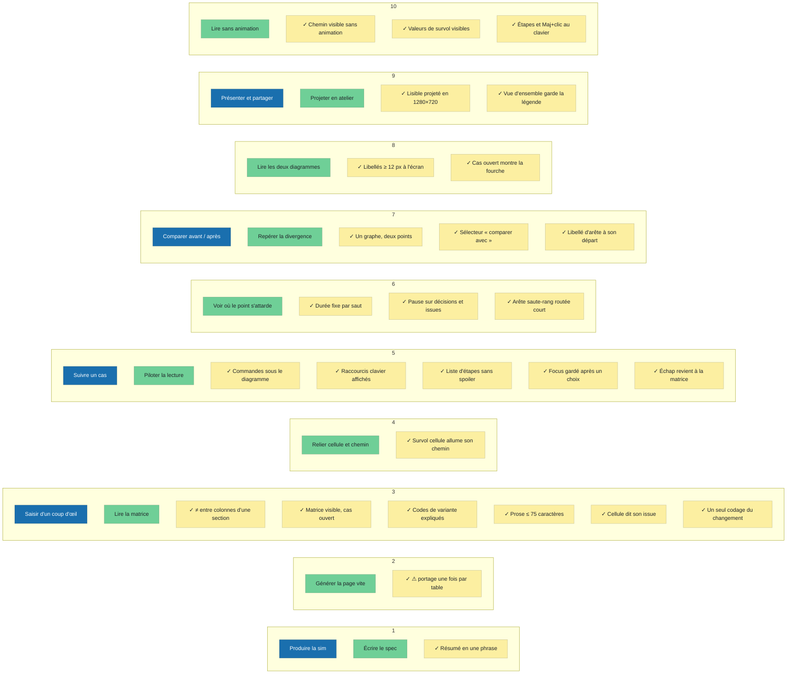

<!-- markdownlint-disable MD013 -- generated by `sideco export`; note threads stay on one line -->
# truepath — parcours lecteur

> **Story Mapping** — What journey does the user follow, and what ships first?

Source: Sideco journal, board `truepath-parcours-lecteur`, seq 1052, exported on 2026-11-19.

## Elements

| Id | Type | Label | Step | Detail | By |
| --- | --- | --- | --- | --- | --- |
| A1 | Activity | Produire la sim | 1 | Auteur : écrit le spec, lance build.py, obtient sim.html ou un refus. | agent |
| T1 | Task | Écrire le spec | 1 | | agent |
| S12 | Story | ✓ Résumé en une phrase | 1 | Fait (tranche 1, non commité). C14 refuse un texte hors budget : titre 60, sous-titre 90, résumé/origine 110, question 90, légende d'étape 70, message 40 caractères. SKILL.md, section Text budget. Le spec de la première grille réelle, tel quel, est refusé (5 textes) ; une copie resserrée passe. | agent |
| T2 | Task | Générer la page vite | 2 | Retour utilisateur : la génération du texte est trop longue. | agent |
| S13 | Story | ✓ ⚠ portage une fois par table | 2 | Fait (tranche 1). Provenance dite une fois sous la table ; un glyphe par valeur seulement si la table mélange plusieurs provenances ; texte complet au survol du libellé. | agent |
| A2 | Activity | Saisir d'un coup d'œil | 3 | Lecteur (PO en atelier, revue MR) : comprend en moins d'une minute quel cas va où. | agent |
| T3 | Task | Lire la matrice | 3 | | agent |
| S7 | Story | ✓ ≠ entre colonnes d'une section | 3 | Fait (tranche 3, non commité). Une ligne est surlignée quand les réponses de la section divergent entre elles ; le ≠ « diffère d'avant » reste, en gris. Légende et aria-label disent les deux. Insécables français dans les mots de la page. | agent |
| S9 | Story | ✓ Matrice visible, cas ouvert | 3 | Fait (tranche 4). Un cas ouvert garde sa ligne de matrice au-dessus des diagrammes, cellules − et + marquées ; un clic sur une autre cellule la compare. Rend les 6 boutons de variante redondants : S16 peut les retirer. | agent |
| S10 | Story | ✓ Codes de variante expliqués | 3 | Fait (tranche 6). Les codes ne sont plus nus nulle part : la ligne du cas et l'en-tête du graphe donnent code et libellé. | agent |
| S11 | Story | ✓ Prose ≤ 75 caractères | 3 | Fait (tranche 1). Sous-titre, résumé, consigne et légende de la matrice plafonnés à 38em (~75 caractères réels ; 75ch en laissait passer ~95). | agent |
| S22 | Story | ✓ Cellule dit son issue | 3 | Fait (tranche 9, non commité). Chaque cellule dit l'issue (libellé du nœud de sortie + pastille de sa couleur), puis la valeur ; ≠ sur la ligne qui diffère d'avant. Une valeur perdue et une valeur écartée exprès ne se lisent plus pareil. build.py passe le libellé des nœuds à la page. | agent |
| S23 | Story | ✓ Un seul codage du changement | 3 | Fait (tranche 9). Plus de fond surligné : ≠ est la seule marque de changement. Légende en une ligne de repères (issues, ≠, réel/illustratif, survol). Bandeau d'aide en légende discrète. | agent |
| T4 | Task | Relier cellule et chemin | 4 | | agent |
| S8 | Story | ✓ Survol cellule allume son chemin | 4 | Fait (tranche 4, non commité). Vue matrice : le graphe complet à droite ; la cellule survolée ou focalisée allume son chemin et prend un liseré ; au chargement, le premier cas surligné est allumé. | agent |
| A3 | Activity | Suivre un cas | 5 | Dev qui corrige un bug : le point parcourt le vrai chemin, le panneau montre ce qui change. | agent |
| T5 | Task | Piloter la lecture | 5 | Lecture, pause, pas à pas, vitesse. | agent |
| S4 | Story | ✓ Commandes sous le diagramme | 5 | Fait (tranche 6, non commité). Lecture, pas à pas, vitesse et zoom sous le diagramme ; la barre du haut ne garde que les onglets ou « ← matrice ». | agent |
| S5 | Story | ✓ Raccourcis clavier affichés | 5 | Fait (tranche 6). Raccourcis affichés à côté des commandes (← → étape, Espace lecture, + − 0 zoom). | agent |
| S6 | Story | ✓ Liste d'étapes sans spoiler | 5 | Fait (tranche 6). Une étape se lit une fois atteinte ; les suivantes sont des « … » numérotés, toujours cliquables. | agent |
| S25 | Story | ✓ Focus gardé après un choix | 5 | Fait (tranche 9). Entrée / Maj+Entrée sur la ligne du cas : le focus reste sur la cellule (vérifié). Focus en tirets couleur encre, distinct du bleu plein d'un côté choisi. | agent |
| S26 | Story | ✓ Échap revient à la matrice | 5 | Fait (tranche 9). Échap revient à la matrice, focus sur la cellule d'origine (vérifié) ; affiché dans les raccourcis. | agent |
| T6 | Task | Voir où le point s'attarde | 6 | | agent |
| S1 | Story | ✓ Durée fixe par saut | 6 | Fait (tranche 2, non commité). Chaque saut dure 0,65 s quelle que soit sa longueur, avec un easing in-out (runtime.html, HOP_MS). Sur la grille réelle, le saut le plus long passe de 8,95 s à 2,35 s, en comptant la pause sur la décision. | agent |
| S2 | Story | ✓ Pause sur décisions et issues | 6 | Fait (tranche 2). Pause de 1,7 s sur une décision, la première divergence ou une issue ; 0,45 s ailleurs (dwellAfter). Règle réécrite dans SKILL.md, Design rules. | agent |
| S3 | Story | ✓ Arête saute-rang routée court | 6 | Fait (tranche 2). layout.py detour() : l'arête longe les boîtes qui la gênent, du côté le plus proche, au lieu de contourner tout le dessin. Sur la grille réelle : ~390 unités au lieu de 1334 ; largeur 1087 → 1030 (la couche des 5 issues reste la plus large, voir S14). Testé. | agent |
| A4 | Activity | Comparer avant / après | 7 | Revue de MR : scénarios côte à côte, première divergence marquée. | agent |
| T7 | Task | Repérer la divergence | 7 | | agent |
| S14 | Story | ✓ Un graphe, deux points | 7 | Fait (tranche 5, non commité). Un graphe pleine taille, un point − et un point + qui portent leur signe ; arête prise par un seul côté = couleur du côté, la divergence devient une fourche. Vaut aussi pour les paires hors grille (refund-window). | agent |
| S16 | Story | ✓ Sélecteur « comparer avec » | 7 | Fait (tranche 6). Les 6 boutons de variante sont retirés : la ligne du cas choisit les deux côtés (clic = +, Maj+clic = −), y compris 1A contre 1B. | agent |
| S17 | Story | ✓ Libellé d'arête à son départ | 7 | Fait (tranche 5). Le libellé d'une arête droite se place sous la jonction, sur la partie qu'elle seule dessine. | agent |
| T8 | Task | Lire les deux diagrammes | 8 | | agent |
| S15 | Story | ✓ Libellés ≥ 12 px à l'écran | 8 | Fait (tranche 5). Le diagramme prend la hauteur restante ; en pas à pas, si les libellés tomberaient sous 12 px, la vue démarre zoomée à 12 px et suit les points (mesuré : 14 px en 1440×900 et 1280×720, contre 5,9 et 4,9 avant). Ajuster et la vue d'ensemble montrent tout. | agent |
| S24 | Story | ✓ Cas ouvert montre la fourche | 8 | Fait (tranche 9). Le cas s'ouvre sur tout le graphe, issues des deux côtés cerclées ; mesuré en 1280×720 : les deux issues visibles. Le premier Lecture ou pas passe à 14 px et suit les points ; zoom remesuré au redimensionnement. | agent |
| A5 | Activity | Présenter et partager | 9 | Présentation technique, support : page projetée, envoyée, relue hors ligne. | agent |
| T9 | Task | Projeter en atelier | 9 | | agent |
| S18 | Story | ✓ Lisible projeté en 1280×720 | 9 | Fait (tranche 7, non commité). 1280×720 mesuré : diagramme à 295 px du haut au lieu de 366, commandes visibles (bas à 655), étape courante visible, panneau latéral défilant dans l'écran. Barre masquée en grille, « ← matrice » à côté de la ligne du cas, origine sur une ligne (complète au survol). Reste 51 px de défilement : la fin de la légende. | agent |
| S19 | Story | ✓ Vue d'ensemble garde la légende | 9 | Fait (tranche 7). La vue d'ensemble garde la légende de l'étape sous le graphe. | agent |
| T10 | Task | Lire sans animation | 10 | Reduced motion, clavier, lecteur d'écran (WCAG AA). | agent |
| S20 | Story | ✓ Chemin visible sans animation | 10 | Fait (tranche 8, non commité). Animations réduites : les points ne disparaissent plus, ils se posent sur leur nœud ; nœuds hors chemin à 0,55 d'opacité au lieu de 0,38. | agent |
| S21 | Story | ✓ Valeurs de survol visibles | 10 | Fait (tranche 8). Les valeurs de survol sont écrites sous l'aperçu de la matrice, mises à jour au survol comme au focus clavier (aria-live). | agent |
| S27 | Story | ✓ Étapes et Maj+clic au clavier | 10 | Fait (tranche 9). Étapes en boutons ; « Clic ou Entrée : comparer en +. Avec Maj : en −. » écrit sous la ligne ; th avec scope ; réglage d'animations réduites suivi sans recharger. Le panneau d'un cas ne répète plus la ligne « Réponse ». | agent |

## Resolved notes

- ✅ N1, agent: Décidé le 2026-11-19 : portée = tout le board, par tranches ; ordre = Moins de texte (S11-S13), puis temps du point, lien matrice-graphe, comparaison, présentation.
- ✅ N2, human: J'ai Ajouté des colonnes pour classer les Tasks dans 2 colonnes distinctes, mais toujours reliées à l'activity d'origine. Re répartis les stories
  - N3, agent: Réparti : Écrire le spec ← S12 ; Générer vite ← S13 ; Lire la matrice ← S7 S9 S10 S11 ; Relier cellule et chemin ← S8 ; Piloter ← S4 S5 S6 ; Où le point s'attarde ← S1 S2 S3 ; Repérer la divergence ← S14 S16 S17 ; Lire les diagrammes ← S15 ; Projeter ← S18 S19 ; Sans animation ← S20 S21.
